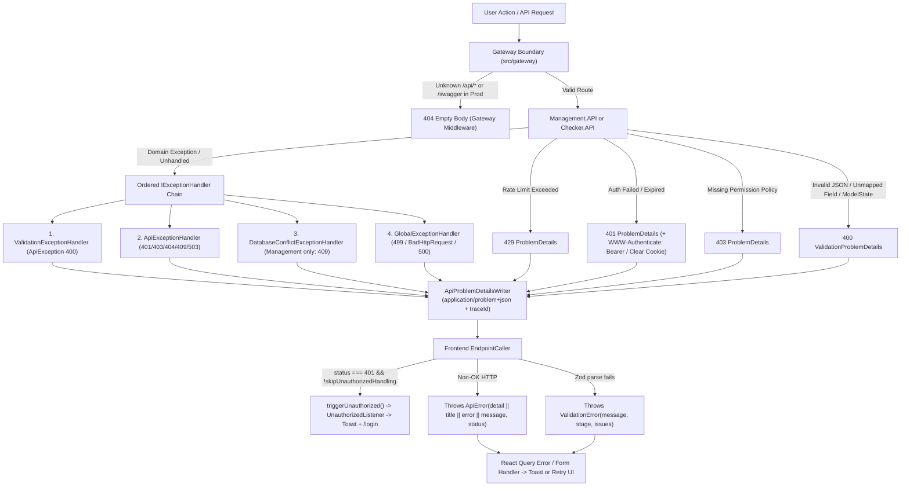

# End-to-End Error Handling Architecture

Every layer across the Gateway, Backend Microservices (`Management` and `Checker`), and Frontend (`Skyeye`) follows deterministic error contracts. Backend APIs standardize on **RFC 9457 `ProblemDetails`** (`application/problem+json`) enriched with `traceId`, while the Frontend converts HTTP and schema failures into typed `AppError` subclasses (`ApiError`, `ValidationError`) and drives recovery through React Query, `AuthGuard`, form field errors, and the global Zustand `toastStore`.

---

## 1. Error Flow Across the Stack



---

## 2. Backend Exception Pipeline (`Management.API` & `Checker.API`)

Both backend services implement the modern ASP.NET Core `IExceptionHandler` chain registered in `Program.cs` alongside `AddProblemDetails(...)` and a custom `ApiProblemDetailsWriter`.

### Custom `IProblemDetailsWriter` (`ApiProblems.cs`)

ASP.NET Core's default MVC problem writer can downgrade `ValidationProblemDetails` into a plain `ProblemDetails` and drop the `errors` dictionary. Both `Management.API` and `Checker.API` register `ApiProblemDetailsWriter` as a singleton so the concrete runtime type (`ValidationProblemDetails` vs `ProblemDetails`) is serialized intact with `Content-Type: application/problem+json`.

`ApiProblems.Enrich(HttpContext, ProblemDetails)` ensures every error payload includes:
- `type`: `https://www.rfc-editor.org/rfc/rfc9110.html#name-<status>-<reason-slug>`
- `title`: Defaults to HTTP reason phrase (or `"Error"` in Checker if empty)
- `status`: HTTP status code
- `instance`: `context.Request.Path`
- `traceId`: `Activity.Current?.Id ?? context.TraceIdentifier`

### Ordered `IExceptionHandler` Chain

1. **`ValidationExceptionHandler`** *(both services)*:
   - Matches `ApiException` with `StatusCode == 400`.
   - Writes `400 Bad Request` `ValidationProblemDetails` containing `errors: Record<string, string[]>`.
2. **`ApiExceptionHandler`** *(both services)*:
   - Matches all other `ApiException` instances (`401`, `403`, `404`, `409`, `503`).
   - Writes `ProblemDetails` with `Status`, `Title`, `Detail`.
3. **`DatabaseConflictExceptionHandler`** *(`Management.API` only)*:
   - Catches `DbUpdateConcurrencyException` or `SqlException` (direct or `InnerException`) with SQL Server error numbers:
     - `2601` (Duplicate unique index row)
     - `2627` (Unique constraint / primary key violation)
     - `547` (Foreign key / reference constraint violation)
     - `1205` (Transaction deadlock victim)
   - Responds with `409 Conflict`: `"The record already exists, has related records, or changed concurrently. Reload and try again."`
4. **`GlobalExceptionHandler`** *(both services)*:
   - If `exception is OperationCanceledException && context.RequestAborted.IsCancellationRequested`: sets status `499` (Client Closed Request) without writing a body.
   - If `exception is BadHttpRequestException badRequest`: writes `ProblemDetails` with `badRequest.StatusCode`, `Title: "Invalid Request"`, `Detail: "The request could not be processed."`.
   - For all other exceptions: logs full stack trace via `ILogger` with `TraceId` and returns a sanitized `500 Internal Server Error` (`Title: "Server Error"`, `Detail: "An unexpected error occurred. Use the traceId when reporting this issue."`). Internal exception messages and stack traces are **never** leaked.

### Additional Error Producers on the Backend

| Source | Status | Payload / Behavior |
| :--- | :--- | :--- |
| **Strict JSON Deserialization** (`UnmappedMemberHandling.Disallow`) + DataAnnotations (`InvalidModelStateResponseFactory`) | `400` | `ValidationProblemDetails` (`Title: "Validation Failed"`, `Detail: "One or more validation errors occurred."`) |
| **Antiforgery Middleware** (`Management.API` cookie-auth writes & `AuthController`) | `400` | `ValidationProblemDetails` / `ProblemDetails` (`Detail: "A valid CSRF cookie and X-CSRF-TOKEN header are required."`) |
| **Identity Errors** (`Management.Infrastructure/Identity/IdentityErrors.cs`) | `409` or `400` | `DuplicateUserName`, `DuplicateRoleName`, `ConcurrencyFailure` -> `409 Conflict`; `Password*` mapped under `"password"`, `*UserName*` under `"userName"`, others under `"request"` -> `400` |
| **JWT Challenge (`OnChallenge`) & `BrowserSessionHandler`** | `401` | Sets `WWW-Authenticate: Bearer` (and deletes invalid `__Secure-DroneVision.Refresh` cookie on `BrowserSession` failure); returns `ProblemDetails` |
| **Authorization Forbidden (`OnForbidden` / `BrowserSessionHandler`)** | `403` | `ProblemDetails` (`Title: "Forbidden"`, `Detail: "You do not have permission to perform this action."`) |
| **Rate Limiter (`OnRejected`)** | `429` | Management (`"credentials"` policy): `"Too many authentication attempts. Try again shortly."`<br/>Checker (global non-health): `"Rate limit exceeded. Try again shortly."` |
| **Empty Status Code Pages (`app.UseStatusCodePages`)** | `404`, `405`, etc. | Converts bare framework status codes (unknown routes, disallowed HTTP methods) into RFC 9457 `ProblemDetails` |
| **Host Wi-Fi Hardware Unavailable (`Checker`)** | `503` | `ApiException.ServiceUnavailable(...)` -> `ProblemDetails` (`Title: "Service Unavailable"`) |

### Standard Error Payloads

**Validation Error (`400 Bad Request`):**
```json
{
  "type": "https://www.rfc-editor.org/rfc/rfc9110.html#name-400-bad-request",
  "title": "Validation Failed",
  "status": 400,
  "detail": "One or more validation errors occurred.",
  "instance": "/api/management/users",
  "errors": {
    "roles": ["One or more roles do not exist."]
  },
  "traceId": "00-abc123...-01"
}
```

**Domain / Auth / Rate-Limit Error (`401` / `403` / `404` / `409` / `429` / `503`):**
```json
{
  "type": "https://www.rfc-editor.org/rfc/rfc9110.html#name-409-conflict",
  "title": "Conflict",
  "status": 409,
  "detail": "The bootstrap Admin role cannot be deleted.",
  "instance": "/api/management/roles/1",
  "traceId": "00-def456...-01"
}
```

---

## 3. Gateway Error Behavior (`src/gateway`)

- **Unknown `/api/*` Path:** Requests starting with `/api` that do not match an `UpstreamPathTemplate` prefix in `ocelot.*.json` return `404 Not Found` with an empty body directly from `Program.cs`.
- **Production Swagger Access:** Requests to `<servicePrefix>/swagger*` when `!IsDevelopment()` return `404 Not Found` with an empty body.
- **Downstream Pass-Through:** All valid routed errors (`400`–`503` `ProblemDetails` from `Management` or `Checker`) pass through Ocelot intact with their original status codes and JSON bodies.

---

## 4. Frontend Error Architecture (`frontend`)

### Typed Error Hierarchy (`frontend/core/errors/`)

| Class / Helper | Fields | Used For |
| :--- | :--- | :--- |
| `AppError` | `message`, `code` (`'APP_ERROR'`) | Base custom error class |
| `ApiError` | `message`, `status`, `code` (`'API_ERROR'`) | Thrown by `EndpointCaller` on any non-2xx HTTP response (both CSRF fetch and target endpoint) |
| `ValidationError` | `message`, `field` (`'requestDataSchema'` \| `'responseSchema'`), `constraints: string[]`, `code` (`'VALIDATION_ERROR'`) | Thrown by `EndpointCaller` when Zod validation fails on outbound request or inbound response |
| `ensureError(value)` | Returns `Error` | Safely normalizes unknown `catch` values into `Error` instances |

### API Client Error Extraction (`frontend/core/client/endpoint-caller.ts`)

1. **Request Schema Validation:** Before making any network call, `requestDataSchema.parse(data)` validates input; failures throw `ValidationError` (`field = 'requestDataSchema'`).
2. **CSRF Pre-flight:** Fetches `GET /api/management/auth/csrf`. On failure or malformed JSON without `requestToken`, throws `ApiError`.
3. **HTTP Error Parsing:** On `!response.ok`, `EndpointCaller.getErrorMessage(json, 'Request failed')` checks keys in exact priority order: **`detail` → `title` → `error` → `message`**, falling back to `'Request failed'`. Because RFC 9457 `ProblemDetails` puts human-readable explanations in `detail` (e.g., `"The bootstrap Admin role cannot be deleted."`), users see actionable backend messages directly.
4. **401 Interception:** If `error instanceof ApiError && error.status === 401 && !options.skipUnauthorizedHandling`, `EndpointCaller` invokes `triggerUnauthorized()`.
   - Endpoints with `skipUnauthorizedHandling: true`: `loginMutation` (so wrong credentials display a toast on `/login`) and `getMeQuery` (handled explicitly by `AuthGuard`).

### Global Session Expiration (`UnauthorizedListener` + `auth-handler.ts`)

1. [`UnauthorizedListener`](../../frontend/features/providers/unauthorized-listener.tsx) registers the global handler via `setUnauthorizedHandler(...)`.
   > [!NOTE]
   > Currently `UnauthorizedListener` is defined in `features/providers/unauthorized-listener.tsx` and exported/tested alongside `auth-handler.ts`, while `features/providers/index.tsx` renders `ThemeProvider`, `ClientProvider`, `NuqsAdapter`, `TooltipProvider`, and `Toaster`. `AuthGuard` also handles `401` directly via `useAuth().logout()`.
2. [`beginSignout()`](../../frontend/core/client/auth-handler.ts) enforces a module-level one-shot boolean latch (`signoutInProgress`) so concurrent `401` responses, `AuthGuard`, and manual `logout()` never show duplicate toasts or trigger overlapping redirects.
3. On sign-out, `useAuth().logout()` calls `POST /api/management/auth/logout` (via `EndpointCaller`, which fetches a CSRF token first), displays a toast (`'Logged out'`), and performs a **hard navigation** (`window.location.href = '/login'`) so `proxy.ts` re-evaluates cookie state server-side and all in-memory TanStack Query cache is wiped.
   - *(Note: `UnauthorizedListener`'s best-effort `fetch('/api/management/auth/logout', ...)` omits `X-CSRF-TOKEN`, which `AuthController.ValidateTransportAsync()` rejects with `400` if a CSRF cookie exists—this is wrapped in `try/catch` before redirecting to `/login`.)*

### React Query, Optimistic Rollback & Modal Abort Handling

- **Query Retries (`get-query-client.ts`):** Queries default to `retry: 1`, `staleTime: 60_000`, `refetchOnWindowFocus: false` (`getMeQuery` overrides `staleTime: 5 * 60_000` and `refetchOnWindowFocus: true`).
- **Optimistic Updates & Rollback (`hooks/use-update-profile.ts`):** `useUpdateProfile()` snapshots `['profile']` and `['auth', 'me']` in `onMutate`, restores snapshots in `onError`, and invalidates both keys in `onSettled`.
- **Modal Cancellation (`hooks/use-modal-abort.ts`):** Dialogs (`CreateRoleDialog`, `EditRoleDialog`, `CreateUserDialog`, `EditUserDialog`, and `useDeleteConfirmation`) create an `AbortSignal` per submission and abort active requests / cancel pending queries when the modal closes. Catch blocks ignore `isAbortError(err)` (`DOMException` with `name === 'AbortError'`) so aborted requests do not show false error toasts.
- **Component & Guard Fallbacks:**
  - `AuthGuard` renders a full-page retry screen (`<p role="alert">{error}</p>` + `Try again` button) when `getMe` fails with a non-401 error (e.g., `500` or network outage).
  - `ProfileContent` and `EditRoleDialog` display inline destructive alert cards with a `Retry` / `Try again` button when their initial data queries fail.
  - Note: Next.js route-segment `error.tsx` / `global-error.tsx` files are not currently defined in `frontend/app/`; runtime handling relies on React Query error states, `AuthGuard`, and toast notifications.

### Toast Alert System (`stores/toast.ts` & `components/toast/`)

- Vanilla Zustand store (`toastStore`) exposes `showToast(message, type = 'info')` and `closeToast(id)` to both React components (`useToast()`) and non-React modules (`toastStore.getState().showToast(...)`).
- Supported variants (`ToastType`): `'success'`, `'error'`, `'warning'`, `'info'`.
- Auto-dismisses after `5000ms` (`ToastItem` timer) or immediately on close button click.
