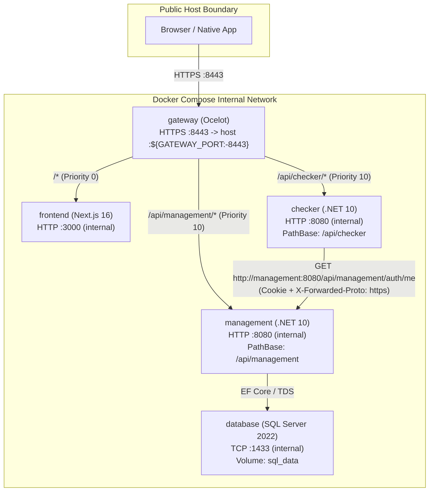
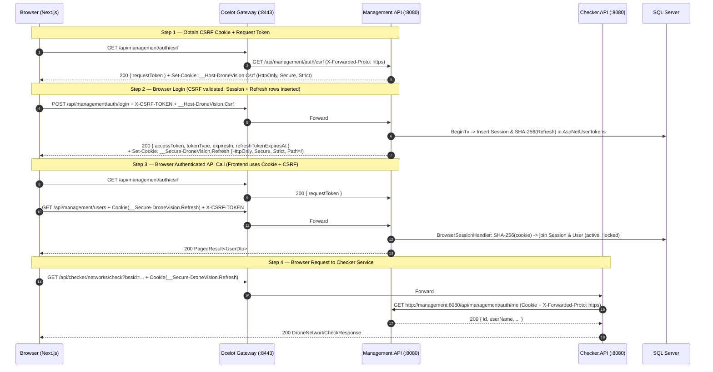

# System Architecture Overview

This document describes the microservices topology, Ocelot API Gateway routing and security boundary, dual-transport authentication and session lifecycle, dynamic RBAC authorization, and inter-service communication across the platform.

---

## 1. High-Level Topology & Network Isolation

### Key Architectural Invariants
1. **Single Public Entry Point:** Only `gateway` publishes a host port (`${GATEWAY_PORT:-8443}:8443`). `frontend`, `management`, `checker`, and `database` only `expose` ports internally inside the Docker network.
2. **Same-Origin Architecture (Zero CORS):** Because the browser loads the Next.js UI from `https://localhost:8443/` and calls APIs on `https://localhost:8443/api/management/*` (and `/api/checker/*`), all requests share the same origin. Cookies with `SameSite=Strict`, `Secure`, `HttpOnly`, and `__Host-` / `__Secure-` prefixes work without CORS preflights or cross-origin cookie exemptions.
3. **Gateway Path Base Alignment:** Both `Management.API` (`Gateway:PathBase=/api/management`) and `Checker.API` (`Gateway:PathBase=/api/checker`) invoke `app.UsePathBase(...)`. As a result, generated resource URLs (e.g., `CreatedAtAction`, `Location` headers, `profileImageUrl` `/api/management/uploads/profiles/...`, and OpenAPI `servers`) resolve with the full gateway prefix.

---

## 2. API Gateway Routing & Boundary Hardening

[`src/gateway/Program.cs`](../../src/gateway/Program.cs) merges all `ocelot.*.json` files into memory via `AddOcelot(builder.Environment, MergeOcelotJson.ToMemory)`:

| Config File | Upstream Template | Downstream Target | Priority | Purpose |
| :--- | :--- | :--- | :--- | :--- |
| `ocelot.management.json` | `/api/management/{everything}` | `http://management:8080/api/management/{everything}` | `10` | Proxies Identity, Auth, Users, Roles, Permissions, Profile & Image APIs |
| `ocelot.checker.json` | `/api/checker/{everything}` | `http://checker:8080/api/checker/{everything}` | `10` | Proxies Drone BSSID/SSID checks, live Wi-Fi scanning & health endpoint |
| `ocelot.frontend.json` | `/` and `/{everything}` | `http://frontend:3000/` and `/{everything}` | `0` | Catch-all SSR/asset routing to Next.js |

### Pre-Ocelot Boundary Middleware (`src/gateway/Program.cs`)
Before `app.UseOcelot()`, every request passes through custom middleware:
1. **Dynamic `/api/*` Prefix Allowlist:** Extracts static prefixes (e.g., `/api/management`, `/api/checker`) from all `Routes[*].UpstreamPathTemplate` values starting with `/api/`. Any `/api/...` request that does not match a known prefix is immediately rejected with `404 Not Found` (so unknown API paths never fall through to the Next.js catch-all route).
2. **Production Swagger Lockout:** When `!app.Environment.IsDevelopment()`, any request matching `<servicePrefix>/swagger` returns `404 Not Found` at the gateway (in addition to Swagger middleware not being registered in downstream services).
3. **Forwarding Header Sanitization:** Unconditionally overwrites `X-Forwarded-Proto` with `context.Request.Scheme` (`https`) and `X-Forwarded-For` with `context.Connection.RemoteIpAddress`. Client-spoofed forwarding headers are discarded so downstream IP rate limiters and `ASPNETCORE_FORWARDEDHEADERS_ENABLED` cookie/HTTPS scheme checks remain trustworthy.

---

## 3. Dual-Transport Authentication Architecture

Both `Management.API` and `Checker.API` configure a policy authentication scheme named **`"BrowserOrBearer"`**:
- If `Authorization` starts with `"Bearer "` (case-insensitive) → forwards to `JwtBearerDefaults.AuthenticationScheme`.
- Otherwise → forwards to **`"BrowserSession"`** (`BrowserSessionHandler`).

### Browser Transport vs. Native/CLI Transport

| Aspect | Browser Transport (Default) | Native / CLI Transport |
| :--- | :--- | :--- |
| **Trigger Header** | Omit `X-Auth-Transport` | Must send `X-Auth-Transport: native` on `/auth/login`, `/auth/refresh`, `/auth/logout` |
| **Header Restrictions** | Requires `__Host-DroneVision.Csrf` cookie + `X-CSRF-TOKEN` header on auth calls & all cookie-authenticated writes (`POST`/`PUT`/`PATCH`/`DELETE`) | Rejects (`400`) if `Origin`, `Sec-Fetch-Site`, or `__Secure-DroneVision.Refresh` cookie is present |
| **Refresh Secret Delivery** | `HttpOnly`, `Secure`, `SameSite=Strict`, `Path=/` cookie (`__Secure-DroneVision.Refresh`); `refreshToken` is `null` in JSON | Returned in JSON (`AuthenticationResponse.RefreshToken`); never set as a cookie |
| **Refresh / Logout Input** | Reads `__Secure-DroneVision.Refresh` cookie; rejects JSON `refreshToken` field with `400` | Reads `{ "refreshToken": "..." }` from JSON body |
| **Session Isolation** | `IsBrowserSession == true` (cannot be used via native transport) | `IsBrowserSession == false` (cannot be used via browser transport) |

### JWT Token & Refresh Token Security Design
- **Access Token (`JwtTokenService`):** Signed with **`HS512`** (`SecurityAlgorithms.HmacSha512`) using a Base64 key of >= 64 random bytes. Contains **only** `sub` (integer User ID), `sid` (integer Session ID in `AspNetUserTokens`), `jti` (16-byte hex ID), `iss` (`DroneVision`), `aud` (`DroneVision.Client`), `nbf`/`iat`/`exp` (`AccessTokenMinutes`, default `15`, `ClockSkew = TimeSpan.Zero`). **Roles and permissions are never embedded in the JWT.**
- **Immediate Revocation on `Management.API`:** `JwtBearerEvents.OnTokenValidated` verifies against SQL Server on every request that the `sid` session row is non-revoked, unexpired, and the user is not locked out.
- **Stateless Validation on `Checker.API`:** `Checker.API` validates the `HS512` signature, `iss`, `aud`, lifetime (`ClockSkew = Zero`), and presence of positive integer `sub`, positive integer `sid`, and non-empty `jti` locally without hitting `Management` on Bearer calls.
- **Refresh Token Rotation & Replay Detection (`AuthService`):**
  - Raw refresh tokens are 64 random bytes (512 bits) Base64Url-encoded (`86` characters).
  - Only the uppercase hex **SHA-256 hash** is stored in `AspNetUserTokens.Name` under provider `DroneVision.Refresh`, protected by filtered unique index `IX_AspNetUserTokens_RefreshHash`.
  - Both `/auth/refresh` and `/auth/logout` execute a transaction acquiring an exclusive SQL Server row lock (`SELECT * FROM [AspNetUserTokens] WITH (UPDLOCK, ROWLOCK)`) on the parent `DroneVision.Session` row.
  - Presenting an already-revoked refresh token (replay or concurrent duplicate) revokes the **entire session family** (`Session.RevokedAtUtc = now`), commits the revocation, and returns `401 Unauthorized`.

---

## 4. Dynamic Permission Authorization (RBAC)

- Canonical permission strings live in [`Management.Application/Authorization/Permissions.cs`](../../src/services/Management/Management.Application/Authorization/Permissions.cs) (`Permissions.All`) and are mirrored in [`frontend/core/auth/permissions.ts`](../../frontend/core/auth/permissions.ts).
- Role grants are stored in `AspNetRoleClaims` with `ClaimType = "permission"`.
- `Management.API` registers one policy per permission in `Permissions.All` plus a `FallbackPolicy` requiring authentication on every endpoint unless `[AllowAnonymous]` is applied.
- [`PermissionAuthorizationHandler`](../../src/services/Management/Management.API/Authorization/PermissionAuthorizationHandler.cs) queries `IPermissionService.HasAsync(userId, requirement.Permission)` on every authorized request against live `AspNetUserRoles` + `AspNetRoleClaims`, so role edits take effect immediately without requiring users to re-authenticate.

---

## 5. Inter-Service Communication Summary

| Caller | Target | Protocol & Path | Purpose | Failure Behavior |
| :--- | :--- | :--- | :--- | :--- |
| `gateway` | `frontend` | `HTTP` (`http://frontend:3000/{everything}`) | Serves Next.js SSR pages & static assets | Upstream `502`/`504` from Ocelot if container down |
| `gateway` | `management` | `HTTP` (`http://management:8080/api/management/{everything}`) | Proxies Management API & Swagger | Upstream `502`/`504` if down |
| `gateway` | `checker` | `HTTP` (`http://checker:8080/api/checker/{everything}`) | Proxies Checker API & Swagger | Upstream `502`/`504` if down |
| `checker` | `management` | `HTTP` (`${Management:BaseUrl}/auth/me`) | Validates browser `__Secure-DroneVision.Refresh` cookie via `ManagementSessionValidator` (`TimeoutSeconds = 3`, `AllowAutoRedirect = false`, `X-Forwarded-Proto: https`) | Logs warning & treats session as invalid (`401 Unauthorized` + deletes cookie) |
| `management` | `database` | `TDS` (`Server=database;Database=DroneVision;...`) | Persists ASP.NET Identity, sessions, refresh hashes, and `ProfileImages` | Startup `IdentityBootstrap` blocks until SQL is healthy (`depends_on: service_healthy`); transient runtime failures map to `500` or `409` |
