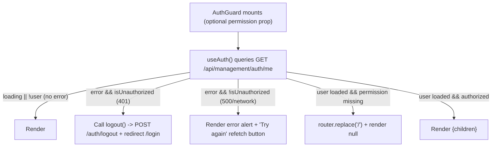

# Frontend — Pages, Layouts & Routing

---

## 1. Layout & Route Group Hierarchy

`frontend/app/` uses Next.js App Router route groups (`(app)`, `(authentication)`, `(dashboard)`) without adding extra URL segments:

```text
app/
├── _shell/
│   ├── index.tsx                      # RootShell: <html>, Roboto & Share_Tech_Mono Google fonts, <AppleSplashScreens />, <Providers>
│   └── AppleSplashScreens.tsx         # 49 iOS launch-screen <link rel="apple-touch-startup-image"> tags
└── (app)/
    ├── layout.tsx                     # RootLayout: exports buildMetadata() & rootViewport; wraps children in <RootShell>
    ├── (authentication)/
    │   ├── layout.tsx                 # Sets metadata title "Login" and wraps in <main>
    │   └── login/page.tsx             # /login -> <LoginPage />
    └── (dashboard)/
        ├── layout.tsx                 # Wraps routes in <DashboardLayout> (SidebarProvider + AppSidebar + Navbar)
        ├── page.tsx                   # / -> <AuthGuard><div>fopko</div></AuthGuard> (overview placeholder)
        ├── users/page.tsx             # /users -> <UsersPage />
        ├── roles/page.tsx             # /roles -> <RolesPage />
        └── profile/page.tsx           # /profile -> <ProfilePage />
```

---

## 2. Server-Side Navigation Gating (`proxy.ts`)

Next.js 16 edge request proxy [`frontend/proxy.ts`](../../../frontend/proxy.ts) runs on all non-static routes (`matcher: ['/((?!api|_next/static|_next/image|favicon.ico|opengraph-image|.*\\.[\\w]+$).*)']`):

- Reads cookie **`__Secure-DroneVision.Refresh`** (`authConfig.sessionCookie`).
- **Rule 1 (Authenticated user visiting `/login`):** If the cookie is present and pathname is in `AUTH_PAGES` (`/login`), redirects (`307`) to `authConfig.defaultRedirect` (`/`).
- **Rule 2 (Unauthenticated user visiting protected route):** If the cookie is absent and pathname is not in `PUBLIC_PAGES` (`/login`), redirects (`307`) to `/login?rp=<pathname><search>`.
- **Authority Boundary:** `proxy.ts` checks cookie *presence* only for instant routing UX; actual cryptographic/DB session validity and RBAC permissions are verified by the Management API via `<AuthGuard>`.

---

## 3. Client-Side Session & Permission Guard (`AuthGuard`)

[`frontend/features/guards/auth-guard/index.tsx`](../../../frontend/features/guards/auth-guard/index.tsx) wraps every protected page:



---

## 4. Pages Reference

### `/login` — Sign-In Page
- **Route File:** `app/(app)/(authentication)/login/page.tsx` → `features/pages/login/index.tsx`
- **Layout:** `(authentication)/layout.tsx` (`<main>`)
- **Auth Guard:** Public (`proxy.ts` redirects away to `/` if `__Secure-DroneVision.Refresh` cookie exists)
- **Components:** `LoginHeader` (Skyeye logo + `ThemeToggle`), `LoginForm`, `LoginVideo` (MQ-9 Reaper MP4 on `lg+` respecting `prefers-reduced-motion: reduce`)
- **Data Flow & User Actions:**
  1. Validates `username` (trimmed, non-empty) and `password` (non-empty) via `loginSchema` (`react-hook-form` + `zodResolver`).
  2. Executes `['auth', 'login']` mutation (`POST /api/management/auth/login` with CSRF pre-flight).
  3. On success: resets password field, shows success toast (`"Signed in successfully."`), and runs hard navigation (`window.location.replace('/')`) so `proxy.ts` observes the new HttpOnly cookie.
  4. On error (`401`/`429`/network): `skipUnauthorizedHandling: true` surfaces backend `ProblemDetails.detail` directly via `showToast(..., 'error')`.

### `/` — Overview Page
- **Route File:** `app/(app)/(dashboard)/page.tsx`
- **Layout:** `DashboardLayout`
- **Auth Guard:** `<AuthGuard>` (authenticated user; no specific permission required)
- **Current Implementation:** Currently renders a placeholder `<AuthGuard><div>fopko</div></AuthGuard>`. Accessible from the `"Overview"` sidebar entry (`constant/sidebar.ts`) and serves as the fallback destination for unauthorized permission redirects (`router.replace('/')`) and login default redirect.

### `/users` — User Management Page
- **Route File:** `app/(app)/(dashboard)/users/page.tsx` → `features/pages/users/index.tsx`
- **Layout:** `DashboardLayout`
- **Auth Guard:** `<AuthGuard permission="Users.View">`
- **Permissions Checked:**
  - Page access: `Users.View`
  - `"Create User"` button (`CreateUserDialog`): `Users.Create`
  - Row `"Edit"` action (`EditUserDialog`): `Users.Update`
  - Row `"Delete"` action (`DeleteUserDialog`): `Users.Delete`
  - Roles dropdown & filter options (`getRolesQuery`): `Roles.View` (gracefully disabled if user lacks `Roles.View`)
- **Data Flow & User Actions:**
  - `UsersTable` syncs `page`, `perPage`, `fullName` (→ `Name`), `roles` (→ `Role`), and `createdAt` (→ `CreatedAtFrom`/`CreatedAtTo`) with URL search params via `nuqs` and queries `GET /api/management/users` (`keepPreviousData`).
  - **Create User:** Dialog form (`createUserSchema`, min 12-char password) → `POST /api/management/users` → invalidates `['users']`.
  - **Edit User:** Loads `GET /api/management/users/{id}`, edits `fullName`/`userName`/`roles` (`PUT /api/management/users/{id}`), and supports uploading (`POST /api/management/users/{id}/profile-image`) or removing (`DELETE /api/management/users/{id}/profile-image`) the user's avatar.
  - **Delete User:** Confirmation modal (`useDeleteConfirmation`) → `DELETE /api/management/users/{id}` → invalidates `['users']`.

### `/roles` — Role Management Page
- **Route File:** `app/(app)/(dashboard)/roles/page.tsx` → `features/pages/roles/index.tsx`
- **Layout:** `DashboardLayout`
- **Auth Guard:** `<AuthGuard permission="Roles.View">`
- **Permissions Checked:**
  - Page access: `Roles.View`
  - `"Create Role"` button (`CreateRoleDialog`): `Roles.Create`
  - Row `"Edit"` action (`EditRoleDialog`): `Roles.Update`
  - Row `"Delete"` action (`DeleteRoleDialog`): `Roles.Delete`
- **Data Flow & User Actions:**
  - `RolesTable` syncs `page`, `perPage`, `name` (→ `RoleName`), and `createdAt` (`CreatedAtFrom`/`CreatedAtTo`) with URL search params and queries `GET /api/management/roles`.
  - **View Permissions:** Eye icon button opens `RolePermissionsDialog` displaying assigned permission badges.
  - **Create / Edit Role:** Uses `PermissionCategorySelect` to toggle entire permission categories (`User Management`, `Role Management`, `Permissions`) via `PERMISSION_GROUPS`. Updating or deleting a role invalidates `['roles']`, `['users']`, `['auth', 'me']`, and `['profile']`.

### `/profile` — User Profile Page
- **Route File:** `app/(app)/(dashboard)/profile/page.tsx` → `features/pages/profile/index.tsx`
- **Layout:** `DashboardLayout`
- **Auth Guard:** `<AuthGuard>` (any authenticated user; linked from `AccountMenu` in `Navbar`)
- **Data Flow & User Actions:**
  - Fetches `GET /api/management/profile` (`getProfileQuery`). Displays skeleton while loading and retry card on fetch error.
  - **Avatar Card:** Shows avatar or 2-letter initials, `"Upload photo"` file picker (`accept="image/jpeg,image/png,image/webp"`, calls `POST /api/management/profile-image`), `"Remove"` confirmation modal (`DeleteProfileImageDialog` → `DELETE /api/management/profile-image`), and read-only assigned `roles` badges. Both image mutations invalidate `['profile']` and `['auth', 'me']`.
  - **Personal Information Form:** Validates `fullName` & `userName` via `updateProfileSchema`; submits via `useUpdateProfile()` with optimistic cache updates to both `['profile']` and `['auth', 'me']` and automatic rollback on failure.
