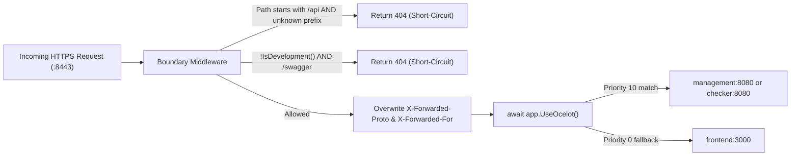

# API Gateway — Architecture & Internal Logic

---

## 1. Request Processing Pipeline (`Program.cs`)

[`src/gateway/Program.cs`](../../../src/gateway/Program.cs) is a minimal 31-line ASP.NET Core host:



### Startup Configuration Merging
1. `builder.Configuration.AddOcelot(builder.Environment, MergeOcelotJson.ToMemory);`
   - Scans the working directory (`src/gateway` / `/src` / `/app`) for all `ocelot.*.json` files and merges their `"Routes"` arrays in memory without writing a `ocelot.json` file to disk.
2. `builder.Services.AddOcelot(builder.Configuration);`
3. Prefix extraction at build time:
   ```csharp
   var servicePrefixes = builder.Configuration.GetSection("Routes").GetChildren()
       .Select(route => route["UpstreamPathTemplate"]?.Split("/{", 2)[0])
       .Where(path => path?.StartsWith("/api/", StringComparison.OrdinalIgnoreCase) == true)
       .Select(path => new PathString(path)).ToArray();
   ```
   Every route starting with `/api/` automatically registers its base segment (e.g., `/api/management`, `/api/checker`) into `servicePrefixes`.

### Boundary Guard Details
- `context.Request.Path.StartsWithSegments("/api")` matches `/api` and `/api/...` (note: segment matching means `/apiv2` would not match `/api`).
- If `isApi` is `true` and no `servicePrefix` matches `StartsWithSegments(prefix)`, the request stops immediately with `StatusCodes.Status404NotFound`.
- If `!app.Environment.IsDevelopment()` and `context.Request.Path.StartsWithSegments(servicePrefix.Add("/swagger"))`, the request stops immediately with `404 Not Found`.
- For all passing requests, `X-Forwarded-Proto` and `X-Forwarded-For` are replaced before invoking `await next(context)`.

---

## 2. Priority Routing & Path Preservation

- `ocelot.frontend.json` defines catch-all templates `/` and `/{everything}` with **`Priority: 0`**.
- Microservice route files (`ocelot.management.json`, `ocelot.checker.json`) define `/api/<service>/{everything}` with **`Priority: 10`**.
- **Path Preservation (`DownstreamPathTemplate`):** Both `Management` and `Checker` routes keep the `/api/<service>/` prefix in `DownstreamPathTemplate` (e.g., `/api/management/{everything}`), matching `Gateway__PathBase` (`/api/management` and `/api/checker`) configured on the downstream containers. This ensures `Request.PathBase`, `CreatedAtAction`, `profileImageUrl`, and Swagger `servers` stay consistent end-to-end.

---

## 3. Container & Watch Architecture

- **`src/gateway/Dockerfile`:**
  - `development` stage: `mcr.microsoft.com/dotnet/sdk:10.0`, restores `Gateway.csproj`, runs `dotnet watch --non-interactive --project Gateway.csproj run --no-launch-profile`.
  - `build` stage: publishes Release output (`-c Release -o /app --no-restore`).
  - `runtime` stage: `mcr.microsoft.com/dotnet/aspnet:10.0`, exposes `8443`, runs `dotnet Gateway.dll`.
- **`src/gateway/compose.yaml`:**
  - `depends_on`: `frontend`, `management`, `checker`.
  - Mounts `../../.certs/gateway.pfx:/certs/gateway.pfx:ro`.
  - Sets `ASPNETCORE_ENVIRONMENT: Production` (overridden to `Development` in root `compose.dev.yaml`).
- **`compose.dev.yaml` Watch Rules:**
  - Syncs `./src/gateway` to `/src` (ignoring `**/bin/`, `**/obj/`, `Dockerfile`).
  - Triggers image rebuild if `./src/gateway/Dockerfile` changes.

---

## 4. Adding a New Microservice Behind the Gateway

1. Create `src/gateway/ocelot.<service>.json` using `Priority: 10`, `UpstreamPathTemplate: "/api/<service>/{everything}"`, and `DownstreamPathTemplate: "/api/<service>/{everything}"`.
2. Configure `Gateway__PathBase: /api/<service>` on the downstream service so generated URLs and Swagger match.
3. Add the new service to `depends_on` in `src/gateway/compose.yaml` and include its compose file in root `compose.yaml`.
4. No changes to `src/gateway/Program.cs` are required—`servicePrefixes` picks up `/api/<service>` automatically from the merged Ocelot configuration.
