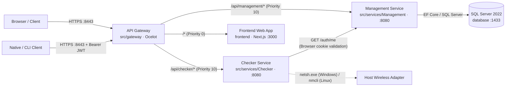

# DroneVision / Skyeye — Engineering Documentation Hub

Welcome to the central engineering documentation for the **drone-analyze** (**DroneVision / Skyeye**) platform. This documentation portal is generated directly from the repository source code and covers every microservice, the Ocelot API Gateway, the Next.js frontend application, infrastructure configuration, API contracts, error handling, testing, and operations.

---

## System Topology



---

## Services & Applications Matrix

| Service / App | Type | Container Port | Native Dev Ports | Path Prefix | Docs Folder | Responsibilities |
| :--- | :--- | :--- | :--- | :--- | :--- | :--- |
| **Gateway** (`src/gateway`) | API Gateway (Ocelot) | `8443` (HTTPS, host-published via `GATEWAY_PORT`) | Default Kestrel (`:5000` unless configured) | `/` & `/api/*` | [`03-services/gateway/`](./03-services/gateway/README.md) | Single public HTTPS ingress, `/api/*` allowlisting, production Swagger lockout, forwarding header sanitization, reverse proxy |
| **Management** (`src/services/Management`) | Microservice (.NET 10) | `8080` (HTTP internal) | `7146` (HTTPS) / `5206` (HTTP) | `/api/management` | [`03-services/management/`](./03-services/management/README.md) | ASP.NET Core Identity, dual-transport auth (browser HttpOnly cookie + native HS512 JWT), RBAC permissions, users, roles, profile & binary image storage |
| **Checker** (`src/services/Checker`) | Microservice (.NET 10) | `8080` (HTTP internal) | `7150` (HTTPS) / `5210` (HTTP) | `/api/checker` | [`03-services/checker/`](./03-services/checker/README.md) | Embedded IEEE OUI/MA-M/MA-S & SSID drone signature evaluation, conservative shared-chipset scoring, live host Wi-Fi drone scanning |
| **Frontend** (`frontend`) | Web App (Next.js 16) | `3000` (HTTP internal) | `3000` (HTTP) | `/` | [`03-services/frontend/`](./03-services/frontend/README.md) | **Skyeye** operator UI: login, auth guard, RBAC-gated navigation, user & role management data tables, profile & avatar management |
| **Database** (`src/deploy/sqlserver`) | Infrastructure (MSSQL 2022) | `1433` (internal) | `localhost:1433` (if native) | N/A | [`01-getting-started/setup-and-run.md`](./01-getting-started/setup-and-run.md) | Persistent SQL Server 2022 storage (`DroneVision` database) backed by Docker volume `sql_data` |

---

## Documentation Directory Index

### 1. Getting Started
- [Setup & Run Guide](./01-getting-started/setup-and-run.md) — Prerequisites, `.env` secrets, TLS certificate generation, Docker Compose Dev/Watch vs Prod vs Native execution.
- [Commands Reference](./01-getting-started/commands-reference.md) — Complete CLI cheatsheet for `pnpm`, Docker Compose, `dotnet`, EF Core migrations, linting, formatting, and testing.

### 2. Architecture
- [System Overview](./02-architecture/system-overview.md) — Microservices topology, Ocelot routing rules, dual-transport authentication, session rotation locking, RBAC authorization, and inter-service calls.
- [End-to-End Error Handling](./02-architecture/error-handling.md) — Ordered ASP.NET Core `IExceptionHandler` pipeline, RFC 9457 `ProblemDetails` contracts, SQL conflict mapping, gateway boundary errors, and frontend `EndpointCaller` / `AuthGuard` / Toast handling.

### 3. Services & Applications
- **API Gateway (`src/gateway`)**
  - [Overview & Configuration](./03-services/gateway/README.md)
  - [Routing & Endpoints](./03-services/gateway/api-endpoints.md)
  - [Architecture & Boundary Logic](./03-services/gateway/architecture-and-logic.md)
  - [Testing & Verification](./03-services/gateway/testing.md)
- **Management Service (`src/services/Management`)**
  - [Overview & Configuration](./03-services/management/README.md)
  - [API Endpoints Reference](./03-services/management/api-endpoints.md)
  - [Architecture, Database & Auth Logic](./03-services/management/architecture-and-logic.md)
  - [Testing & Verification](./03-services/management/testing.md)
- **Checker Service (`src/services/Checker`)**
  - [Overview & Configuration](./03-services/checker/README.md)
  - [API Endpoints Reference](./03-services/checker/api-endpoints.md)
  - [Architecture, Catalog & Scanning Logic](./03-services/checker/architecture-and-logic.md)
  - [Testing Guide](./03-services/checker/testing.md)
- **Frontend Application (`frontend`)**
  - [Overview & Configuration](./03-services/frontend/README.md)
  - [Pages & Routing](./03-services/frontend/pages-and-routing.md)
  - [Components, Hooks & DataTable Catalog](./03-services/frontend/components-catalog.md)
  - [Testing Guide](./03-services/frontend/testing.md)

### 4. Operations
- [Troubleshooting & Debugging Runbook](./04-operations/troubleshooting.md) — TLS cert issues, SQL Server bootstrap locks, CSRF/cookie failures, Windows Docker Wi-Fi scan `503` constraints, rate limits, and Playwright setup.

---

## Quick Start (Docker Development with Hot Reload)

From the repository root:

```powershell
# 1. Create environment configuration and HTTPS gateway certificate
Copy-Item .env.example .env
# Edit .env with unique strong passwords and a 64+ byte Base64 JWT_SIGNING_KEY

New-Item -ItemType Directory -Force .certs | Out-Null
dotnet dev-certs https -ep .certs/gateway.pfx -p 'your-GATEWAY_CERT_PASSWORD'
dotnet dev-certs https --trust

# 2. Build development images, start containers, and attach Compose Watch
pnpm docker:dev
```

Once healthy, access the platform through the Gateway:
- **Frontend UI:** `https://localhost:8443`
- **Management Swagger (Development only):** `https://localhost:8443/api/management/swagger/index.html`
- **Checker Swagger (Development only):** `https://localhost:8443/api/checker/swagger/index.html`
- **Checker Health Probe:** `https://localhost:8443/api/checker/health`
